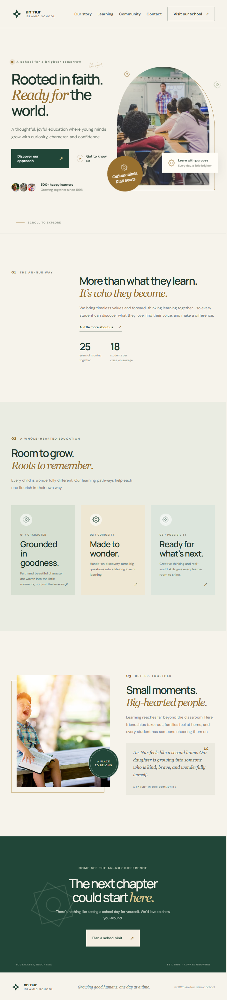

# An-Nur Islamic School

A responsive, single-page website concept for **An-Nur**, a fictional madrasah in Yogyakarta, Indonesia. The name means “the light.” The page introduces the school's values, learning approach, and community, then invites prospective families to arrange a visit.

The design combines a calm Islamic-inspired palette—deep emerald, warm ivory, sage, and restrained gold—with geometric rosette motifs, generous spacing, photography, and subtle animation. It is built with plain HTML, CSS, and JavaScript; there is no framework, build step, or package installation.

## Full-page preview



## Page sections

- **Hero:** School introduction, primary calls to action, learner social proof, and classroom photography.
- **Our story:** The school's educational philosophy and example school statistics.
- **Learning:** Three learning themes: character, curiosity, and future readiness.
- **Community:** A family-focused message and testimonial.
- **Visit:** A contact call to action linking to the school's email address.
- **Footer:** School identity, tagline, and a year that updates automatically.

## Features

- Responsive desktop and mobile layouts, including a collapsible mobile navigation menu.
- Animated image entrance, floating note, hover details, and scroll-triggered section reveals.
- Reduced-motion support for visitors who prefer fewer animations.
- Reusable inline SVG Islamic rosette motifs.
- Semantic page landmarks, descriptive image text, and accessible navigation labels.
- No tracking, server-side code, or third-party JavaScript libraries.

## Run locally

No installation is necessary. Open `index.html` directly in a modern browser.

Alternatively, start a local static web server from the project directory:

```powershell
python -m http.server 8000
```

Then visit [http://localhost:8000](http://localhost:8000). Stop the server with `Ctrl+C`.

## Project files

```text
an-nur/
├── index.html       # Page content, metadata, navigation, and inline SVG motifs
├── styles.css       # Theme, layout, responsive rules, and animations
├── script.js        # Mobile navigation, scroll reveals, and footer year
├── screenshot.png   # Full-page visual preview
└── README.md        # Project overview and usage notes
```

## Customization

- **School name and page content:** Edit the headings, copy, navigation labels, and contact link in `index.html`.
- **Colors and typography:** Update the custom properties at the top of `styles.css`. The current palette uses warm ivory (`--paper`), deep green (`--ink` and `--green`), and muted gold (`--gold`).
- **Photography:** Replace the Unsplash image URLs in `index.html` with images you have permission to use. The page currently loads its photography from Unsplash.
- **Fonts:** The page loads DM Sans and Manrope from Google Fonts, with system font fallbacks in `styles.css`.
- **Animations and navigation:** Adjust the scroll-reveal and mobile-menu behavior in `script.js`, and the corresponding visual effects in `styles.css`.

## External resources and notes

An internet connection is needed to load Google Fonts and the remote Unsplash photographs. Without it, the page still displays using fallback fonts, but remote images may not appear.

An-Nur, the school statistics, and the testimonial are fictional content for this design concept. Replace them with verified information before publishing a real school's website. The example visit link uses `hello@annur.school`; update it to the correct school contact address before launch.
